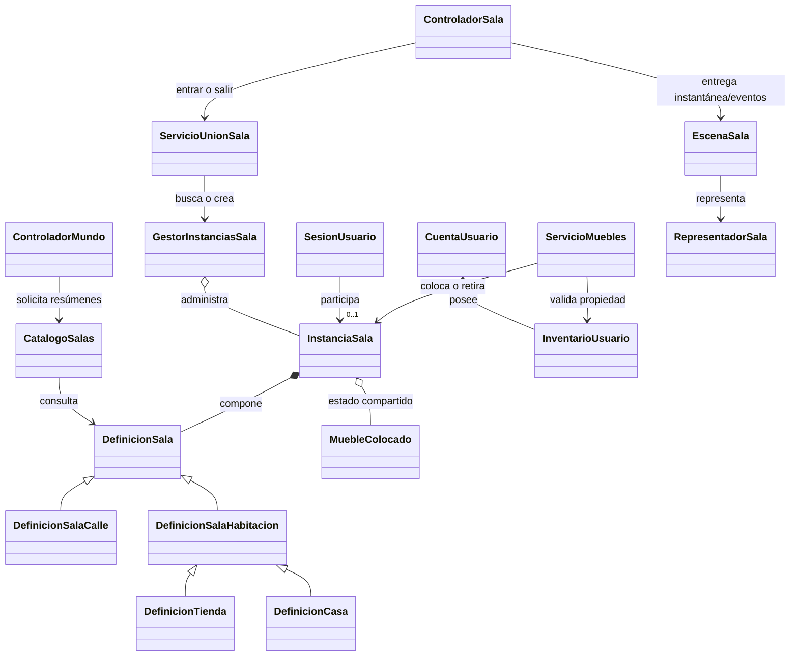
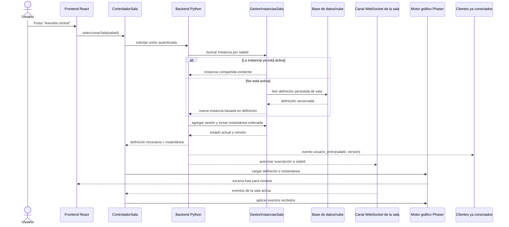

# Propuesta de separación: backend, frontend y motor gráfico

## Alcance

Este documento describe una arquitectura objetivo para WORSHIP WORLD. Es una
propuesta teórica: no crea servicios, no modifica el frontend actual y no
instala dependencias.

El repositorio actual usa Astro y Phaser. Esta propuesta futura contempla
React para la interfaz y un backend en Python. Astro podría conservarse como
contenedor web o dejar de usarse si se decide otra estructura. La integración
de React, el framework Python, la base de datos y el protocolo definitivo deben
decidirse antes de implementar.

La regla central es: **el navegador solo carga y representa la sala en la que
está el usuario; el backend conserva y valida el estado compartido**.

## Responsabilidades por capa

| Capa | Responsabilidades | No debe hacer |
| --- | --- | --- |
| Frontend React | Inicio de sesión, perfil visible, catálogo resumido, navegación, menú privado, solicitudes al backend y manejo de conexión. | Ser autoridad de posiciones, permisos, inventario o muebles colocados. |
| Motor gráfico Phaser | Dibujar una sala seleccionada, sus baldosas, paredes, jugadores y muebles visibles; adaptar cámara y escala; recibir un estado y eventos para actualizar la escena. | Consultar la base de datos, autenticar, decidir pertenencias o sincronizar por su cuenta con todos los clientes. |
| Backend Python | Autenticar; entregar el catálogo; administrar definiciones e instancias de salas; validar uniones, salidas, movimiento y muebles; publicar instantáneas y eventos; aplicar persistencia. | Renderizar gráficos o enviar al cliente todas las salas y todos los inventarios al inicio. |
| Persistencia | Guardar cuentas, definiciones, inventarios y el estado de sala que se acuerde conservar. | Ser accedida directamente por React o Phaser. |

El motor gráfico es una parte del cliente, no otro servidor. Puede representarse
como un módulo independiente de Phaser que recibe datos ya validados y los
transforma en gráficos.

## Modelo de dominio propuesto

Las clases siguientes son responsabilidades conceptuales, no clases ya
implementadas:

| Clase propuesta | Capa | Responsabilidad |
| --- | --- | --- |
| `CatalogoSalas` | Backend | Consultar resúmenes para mostrar en el navegador. |
| `DefinicionSala` | Backend/dominio | Datos estables de una sala: identificador, nombre, tipo, dimensiones y distribución. |
| `DefinicionSalaCalle` | Backend/dominio | Reglas y datos específicos de una calle. |
| `DefinicionSalaHabitacion` | Backend/dominio | Base de interiores. Puede tener especializaciones `DefinicionTienda` y `DefinicionCasa`. |
| `GestorInstanciasSala` | Backend | Encontrar, crear y liberar instancias activas. Una instancia se identifica por sala y, si aplica, grupo. |
| `InstanciaSala` | Backend/dominio | Estado vivo compartido: miembros conectados, entidades presentes, muebles colocados y versión. Compone una definición. |
| `SesionUsuario` | Backend | Identidad autenticada de la conexión y cero o una sala actual. |
| `InventarioUsuario` | Backend/dominio | Muebles que pertenecen a la cuenta. Solo se consulta cuando hace falta. |
| `ServicioUnionSala` | Backend | Validar permisos y capacidad; coordinar el cambio de sala y producir la instantánea inicial. |
| `ServicioMuebles` | Backend | Validar propiedad y reglas antes de colocar o retirar muebles. |
| `ControladorMundo` | Frontend React | Solicitar datos del mundo y coordinar selección, carga y salida de sala. |
| `ControladorSala` | Frontend React | Mantener la suscripción de la sala activa y pasar instantáneas/eventos al motor gráfico. |
| `MenuUsuario` | Frontend React | Interfaz privada: perfil, opciones e inventario solicitado por demanda. |
| `EscenaSala` | Phaser | Dibujar la sala activa y actualizar la representación al recibir estado o eventos. |
| `RepresentadorSala` | Phaser | Dibujar el modelo visual usando los datos espaciales recibidos. |

`InstanciaSala` compone `DefinicionSala`; no hereda de ella. La definición
describe qué sala es. La instancia es una ejecución compartida y temporal de
esa definición. `SesionUsuario` se relaciona con cero o una instancia activa.
Una instancia admite muchas sesiones. El inventario pertenece a la cuenta,
mientras `MuebleColocado` pertenece al estado de una instancia y referencia a
quien lo colocó o posee según las reglas acordadas.



## Qué carga el cliente y cuándo

La carga debe ser progresiva. Al inicio no se construye una escena por sala ni
se envían todos los elementos del mundo.

### Al iniciar sesión

El frontend recibe únicamente:

- identidad pública mínima necesaria para la interfaz;
- preferencias pequeñas, si se necesitan para iniciar;
- lista paginada o acotada de resúmenes de salas: `id`, nombre, tipo,
  dimensiones resumidas, ocupación aproximada y estado disponible;
- credencial de sesión segura según el mecanismo de autenticación elegido.

No recibe las definiciones espaciales completas de todas las salas, todas las
instancias activas, todos los jugadores del mundo ni todos los inventarios.

### Al entrar a una sala

El cliente envía solo el identificador de destino y la operación de unión. El
backend responde con:

- resultado de autorización y datos de la suscripción a esa sala;
- definición espacial necesaria para esa sala, si el cliente no tiene la misma
  versión en caché;
- instantánea inicial de esa instancia: versión, usuarios presentes y estado
  visual requerido;
- muebles actualmente colocados, con identificador de catálogo y posición;
- datos mínimos de las entidades que el motor gráfico necesita dibujar.

Después de recibir la instantánea, el cliente recibe eventos únicamente de esa
instancia: entradas y salidas, cambios de estado y colocación o retiro de
muebles. El frontend cierra la suscripción anterior al cambiar de sala.

### Al abrir el menú del usuario

El menú se abre localmente en React y nunca se replica a otros usuarios. El
cliente pide el inventario cuando el usuario abre la sección de muebles; recibe
una lista resumida de los muebles disponibles y carga recursos gráficos solo
para los elementos que va a mostrar. Poseer un mueble no implica que esté
colocado en la sala.

## Contratos de comunicación ilustrativos

Los siguientes contratos son ejemplos JSON para explicar el flujo, no endpoints
ya existentes. Los nombres de campos se pueden ajustar al estándar que se
adopte. En HTTP, JSON intercambia datos; para tiempo real se propone un canal
WebSocket autenticado. El backend debe validar cada mensaje, aunque el cliente
lo haya generado con TypeScript.

### 1. Catálogo liviano

```http
GET /api/mundo/salas?pagina=1
Authorization: Bearer <credencial>
```

```json
{
  "salas": [
    {
      "id": "calle-principal",
      "nombre": "Calle principal",
      "tipo": "calle",
      "ocupacion": 5,
      "disponible": true
    },
    {
      "id": "tienda-ropa-centro",
      "nombre": "Tienda de ropa",
      "tipo": "tienda",
      "ocupacion": 2,
      "disponible": true
    }
  ],
  "pagina": 1
}
```

### 2. Unión a una sala

```json
{
  "tipo": "solicitar_union",
  "salaId": "calle-principal",
  "idOperacion": "op-usuario-123-45"
}
```

El servidor autentica la sesión; no confía en un `usuarioId` enviado por el
navegador como identidad. Busca la instancia pública activa o la crea. Comprueba
permisos y capacidad y evita procesar dos veces el mismo `idOperacion`.

Respuesta conceptual:

```json
{
  "tipo": "union_aceptada",
  "salaId": "calle-principal",
  "version": 42,
  "definicion": {
    "version": 3,
    "tipo": "calle",
    "ancho": 20,
    "profundidad": 15,
    "distribucion": "cruz"
  },
  "usuarios": [
    { "id": "u1", "nombre": "Lina", "x": 4, "y": 5 },
    { "id": "u2", "nombre": "Mateo", "x": 5, "y": 5 }
  ],
  "mueblesColocados": []
}
```

El ejemplo muestra solo dos usuarios para mantenerlo legible; la respuesta
real incluye los cinco ocupantes previos y el usuario que acaba de entrar. La
definición puede omitirse cuando el cliente ya tiene la misma versión.

### 3. Evento posterior de la misma sala

```json
{
  "tipo": "usuario_entro",
  "salaId": "calle-principal",
  "version": 43,
  "usuario": { "id": "u9", "nombre": "Sara", "x": 8, "y": 7 }
}
```

Todo evento tiene sala y versión. El backend lo envía a los miembros de esa
sala, no a todas las conexiones del mundo. El cliente descarta eventos de una
sala que ya abandonó y solicita resincronización si detecta un salto de versión.

### 4. Solicitud para colocar un mueble

```json
{
  "tipo": "solicitar_colocacion_mueble",
  "salaId": "casa-ana",
  "idOperacion": "op-usuario-123-46",
  "muebleId": "silla-madera-01",
  "x": 4,
  "y": 3,
  "orientacion": 0
}
```

El servidor identifica al propietario desde la sesión autenticada, comprueba
que el mueble existe en su inventario, que la sesión está en esa sala y que la
posición/reglas permiten colocarlo. Si es válido, actualiza inventario e
instancia como una operación consistente y emite `mueble_colocado` a los
miembros. Si falla, devuelve un rechazo explícito; la escena no debe presentar
como confirmado un cambio que el servidor rechazó.

## Caso concreto: dos usuarios entran donde ya hay cinco

1. Los usuarios A y B han recibido el catálogo liviano; ninguno ha cargado
   todavía la geometría de todas las salas.
2. A selecciona `calle-principal`. El frontend pide la unión al backend.
3. `ServicioUnionSala` obtiene la instancia existente con cinco usuarios,
   registra a A una sola vez y genera una instantánea con seis.
4. El frontend de A crea o actualiza su `EscenaSala` con la definición y esa
   instantánea. Los cinco usuarios existentes reciben `usuario_entro(A)`.
5. B solicita unirse a ese mismo identificador. El gestor devuelve la misma
   instancia, ahora con seis usuarios.
6. El servidor agrega a B y entrega una instantánea con siete. A y los otros
   cinco reciben `usuario_entro(B)`.
7. El servidor mantiene el orden de cambios por instancia. El cliente dibuja
   los estados recibidos, pero el servidor decide si una acción es válida.

La sesión está en una sola sala a la vez. Para cambiar, el backend valida el
destino y coordina la salida de la sala actual con la entrada en la nueva. Si
la entrada se rechaza, el cliente conserva la sala anterior. La política exacta
de si ambas operaciones son atómicas o si se permite un estado temporal “en
transición” debe definirse antes de implementar reconexiones.

## Flujo concreto: clic en «Avenida central»

Hay que distinguir dos cosas que suelen llamarse “la sala”:

1. **Definición persistente:** datos que identifican y describen la sala:
   `salaId`, nombre, tipo, dimensiones, distribución y configuración espacial.
   Se guarda en la nube (normalmente en una base de datos) para poder
   recuperarla aunque no haya usuarios conectados.
2. **Instancia activa:** ejecución temporal de esa definición: usuarios
   conectados, posiciones actuales, muebles colocados durante la sesión y
   versión del estado. El backend la mantiene mientras está activa y persiste
   los datos que el juego requiera conservar. No significa que una copia
   completa se descargue al arrancar cada cliente.

La nube es almacenamiento y servicios del backend; no es una escena que el
navegador consulte directamente. El backend lee la definición, administra la
instancia y envía datos serializados. El motor gráfico solo recibe esos datos
del frontend y los dibuja.

### A. Usuario selecciona la sala

1. React ya muestra un catálogo ligero con `salaId`, nombre y tipo. Al pulsar
   **Avenida central**, `ControladorMundo` le pide a `ControladorSala` entrar
   usando el identificador, no una copia completa de todos los datos.
2. `ControladorSala` envía una solicitud autenticada al backend, por ejemplo
   `solicitar_union { salaId, idOperacion }`.
3. El backend valida quién es la sesión, si puede entrar y si hay capacidad.
   `GestorInstanciasSala` busca la instancia activa de esa sala; si no existe,
   carga la definición guardada en la nube y crea una instancia.
4. El backend registra al usuario una sola vez y produce una instantánea
   consistente de esa instancia.
5. El backend devuelve la definición espacial si el cliente no tiene su misma
   versión, y la instantánea actual de usuarios y objetos visibles. También
   autoriza la suscripción a eventos de **esa sala**.
6. React actualiza la pantalla y pasa la respuesta a `ControladorSala`. Este
   prepara el modelo espacial cliente y entrega definición e instantánea a
   `EscenaSala`/`RepresentadorSala`.
7. Phaser dibuja el suelo, las paredes, los muebles y las representaciones de
   los jugadores. React contiene/ordena la interfaz; no dibuja los rombos ni
   convierte coordenadas isométricas.
8. Los otros clientes ya suscritos reciben `usuario_entro` por WebSocket y
   actualizan la misma sala en sus motores gráficos locales.



### B. Qué recibe exactamente el cliente al entrar

Para representar una sala, el cliente necesita datos de presentación, no acceso
a la base de datos. Una instantánea conceptual podría ser:

```json
{
  "salaId": "avenida-central",
  "versionDefinicion": 4,
  "versionEstado": 108,
  "definicion": {
    "tipo": "calle",
    "ancho": 20,
    "profundidad": 15,
    "distribucion": "cruz"
  },
  "usuarios": [
    { "id": "u-12", "nombre": "Lina", "x": 4, "y": 5, "orientacion": "este" },
    { "id": "u-31", "nombre": "Mateo", "x": 7, "y": 8, "orientacion": "norte" }
  ],
  "mueblesColocados": [],
  "suscripcion": { "canal": "sala:avenida-central" }
}
```

Los valores `x` e `y` son posiciones lógicas de la cuadrícula, no píxeles. La
definición puede omitirse si React ya tiene cacheada exactamente la versión 4.
Los gráficos de los avatares o muebles pueden ser recursos estáticos cacheables;
el backend normalmente envía sus identificadores y estado, no imágenes ni
comandos de dibujo. La respuesta real contiene los usuarios y muebles que haya
en esa instancia, respetando permisos y reglas de privacidad.

### C. Movimiento de un usuario y representación para los demás

El motor gráfico no manda un “dibujo del movimiento”. La dirección del flujo es:

1. El usuario pulsa una dirección o elige un destino en el frontend.
2. El cliente envía por WebSocket una **intención de movimiento**, identificada
   con `salaId`, secuencia del cliente y dirección/destino lógico.
3. El backend comprueba que la conexión sigue perteneciendo a esa sala y aplica
   las reglas autoritativas de velocidad, límites, obstáculos y estado. El
   cliente no puede imponer directamente una posición arbitraria.
4. Si el movimiento es válido, el backend actualiza la posición canónica y la
   versión de la instancia; después emite un evento de estado a los miembros de
   esa sala. Si no es válido, responde con rechazo o corrección para el emisor.
5. Cada `ControladorSala` recibe el evento y se lo entrega a su `EscenaSala`.
   Phaser convierte la posición lógica a pantalla con la cuadrícula y dibuja el
   avatar en el lugar actualizado.
6. Para evitar saltos visuales, el motor gráfico puede interpolar localmente
   entre la posición dibujada y la confirmada. La interpolación solo suaviza la
   imagen; no cambia cuál es la posición autoritativa del servidor.

Ejemplos de mensajes:

```json
{
  "tipo": "solicitar_movimiento",
  "salaId": "avenida-central",
  "secuenciaCliente": 57,
  "direccion": "este"
}
```

```json
{
  "tipo": "posicion_actualizada",
  "salaId": "avenida-central",
  "versionEstado": 109,
  "usuarioId": "u-12",
  "x": 5,
  "y": 5,
  "orientacion": "este",
  "secuenciaCliente": 57
}
```

El evento se distribuye solo a las sesiones suscritas a `avenida-central`.
Phaser no abre un WebSocket: el controlador React mantiene la conexión y
entrega los eventos al motor. Si el usuario cambia de sala, el controlador
cancela la suscripción anterior; los eventos antiguos se ignoran comprobando
`salaId` y versión.

El ritmo exacto de simulación, la frecuencia de envío, si se transmite cada paso
o un destino final, y si se permite predicción local son decisiones de diseño
que dependen de la sensación de movimiento deseada y de las reglas del juego.
Para una primera versión conviene enviar intenciones discretas y aceptar solo
posiciones confirmadas por el servidor, añadiendo interpolación visual en
Phaser.

## Renderizado de una sala, no de todo el mundo

En cada navegador se crea una sola instancia de `Phaser.Game`. La interfaz
mantiene el catálogo y selecciona un identificador; el controlador solicita la
unión y entrega a Phaser la definición e instantánea de esa sala. La escena
representa solo ese escenario. Al cambiar de sala, el controlador cancela la
suscripción previa, reemplaza los datos gráficos y ajusta la cámara, sin crear
un `Phaser.Game` por usuario o por clic.

Cada usuario tiene su propio renderizado local de la misma instancia
compartida. El backend no envía píxeles: envía estado serializable. Phaser no
envía gráficos al servidor: emite solicitudes o acciones que el servidor
valida.

## Estructura de proyecto objetivo

Un futuro monorepo podría separar paquetes por responsabilidad. Esta
organización es ilustrativa y no exige microservicios:

```text
backend/
  aplicacion/
    api/
    tiempo_real/
    servicios/
  dominio/
    mundo/
    salas/
    usuarios/
    inventario/
  infraestructura/
    persistencia/
    autenticacion/
  pruebas/

frontend/
  src/
    aplicacion/
    componentes/
    estado/
    servicios/
    motor_grafico/
      escenas/
      representadores/
      adaptadores/

contratos/
  http/
  eventos/
```

Frontend, motor gráfico y backend son límites de módulos; no necesariamente
despliegues separados. Para la primera versión, un backend Python modular único
puede atender API y WebSocket y administrar muchas instancias de sala. El
framework Python, protocolo de autenticación, base de datos, serialización y
escalamiento se deciden como pasos técnicos posteriores.

## Orden recomendado para implementar después

1. Acordar tipos de salas, públicas/privadas, capacidad, persistencia, identidad
   y reglas de muebles.
2. Definir los contratos JSON HTTP y eventos en tiempo real; probarlos con
   datos de ejemplo antes de integrar frameworks.
3. Separar resumen de sala, definición estática e instancia activa en el modelo
   de dominio.
4. Implementar backend modular y pruebas unitarias de unión, salida, capacidad,
   idempotencia e inventario.
5. Crear frontend React para autenticación, catálogo, perfil y menú; pedir
   datos completos bajo demanda.
6. Adaptar Phaser para recibir instantáneas/eventos de una única sala y
   reemplazar el estado visual al navegar.
7. Probar con siete clientes: cinco ya conectados y dos que se unen, verificando
   versiones, usuarios visibles, salida, pérdida de conexión y reconexión.

Hasta completar estos pasos, `Mundo`, `Sala`, Astro y Phaser del repositorio
actual siguen siendo locales y no ofrecen esta sincronización. Esta propuesta
no afirma que React o un backend Python ya estén instalados.

