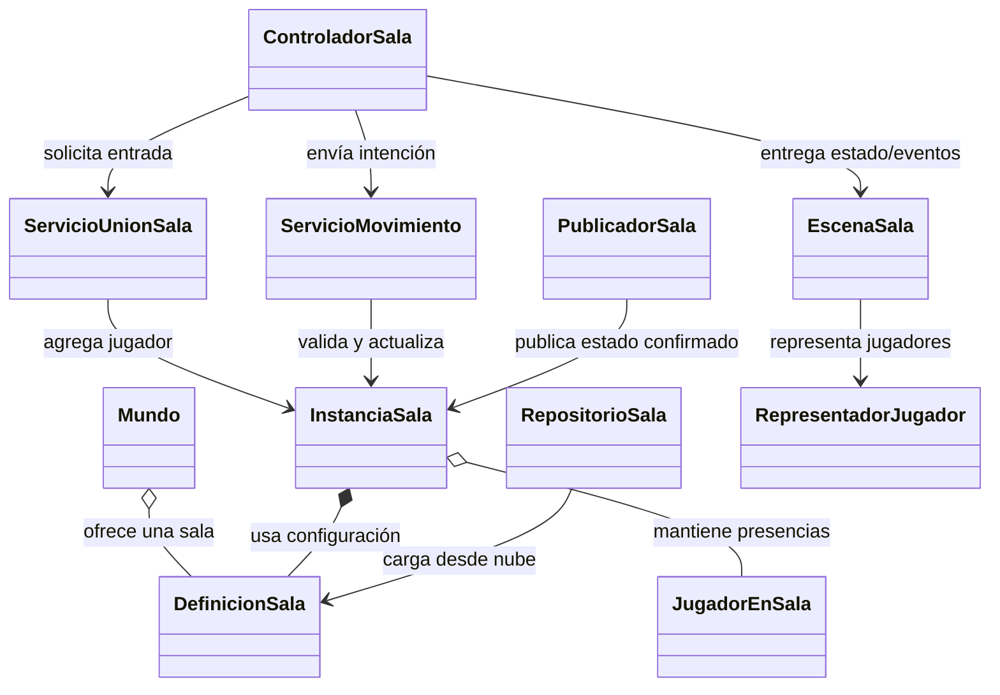
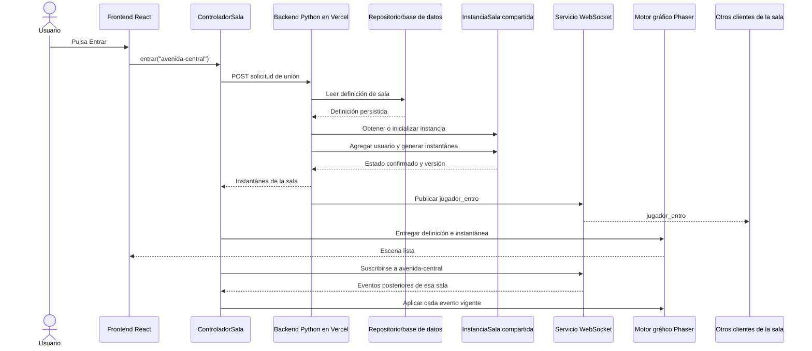
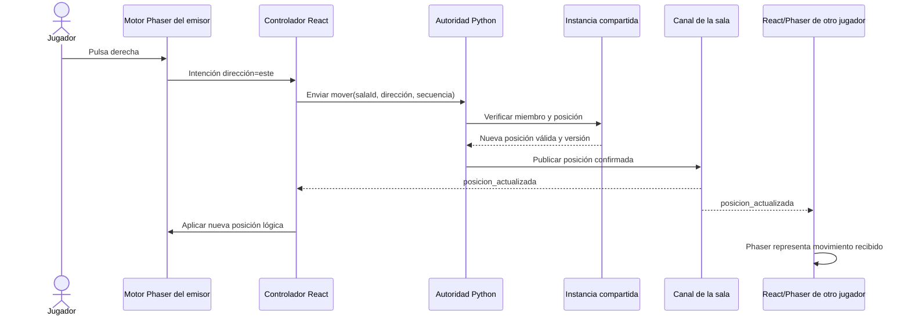

# Arquitectura mínima: un mundo, una sala y movimiento

## Alcance de esta propuesta

Este documento es únicamente teórico. Define una primera arquitectura para
WORSHIP WORLD con:

- un mundo;
- una sola sala pública, persistida en la nube;
- varios usuarios conectados a esa misma sala;
- movimiento básico de los usuarios;
- frontend React, motor gráfico Phaser y backend Python;
- frontend y funciones HTTP del backend desplegados en Vercel.

No implementa código ni presupone que estas tecnologías ya estén instaladas.
El protocolo de tiempo real y los servicios de persistencia deberán elegirse y
verificarse antes de comenzar la implementación.

## Decisión clave: una sala persistente y una instancia activa

Para evitar confundir conceptos, hay dos datos diferentes:

1. **Definición de sala:** configuración estable guardada en la nube:
   identificador, nombre, ancho, profundidad y distribución. Existe aunque no
   haya jugadores conectados.
2. **Estado activo de la sala:** usuarios presentes y sus posiciones actuales.
   Cambia durante el juego y debe tener una fuente autoritativa compartida.

Para esta primera versión hay una sola definición, por ejemplo
`avenida-central`, y una sola instancia pública asociada. Todos los jugadores
que entran reciben el estado de esa misma instancia. No se crean copias
individuales por navegador.

El frontend nunca lee la base de datos directamente. React solicita datos al
backend. El backend accede a almacenamiento administrado en la nube. El motor
gráfico recibe datos desde React y dibuja; no accede por sí mismo a la nube.

## Arquitectura por capas

| Capa | Ubicación | Responsabilidad en esta fase |
| --- | --- | --- |
| Interfaz | React en el navegador, alojado en Vercel | Mostrar la sala, nombre del usuario, estado de conexión y controles de movimiento. |
| Coordinación cliente | React/TypeScript en el navegador | Solicitar entrada, mantener la conexión en tiempo real, enviar intenciones de movimiento y entregar instantáneas/eventos al motor. |
| Motor gráfico | Phaser/TypeScript en el navegador | Mantener una escena visible, convertir posiciones de cuadrícula a pantalla, dibujar avatares y suavizar visualmente el movimiento. |
| API de aplicación | Python en funciones backend de Vercel | Autenticar, autorizar la unión, validar comandos de movimiento y responder con instantáneas o errores. |
| Servicio de tiempo real | Servicio administrado de WebSocket/pub-sub, o proceso dedicado | Mantener las conexiones y distribuir eventos a los miembros de la sala. |
| Persistencia | Base de datos administrada | Guardar definición de sala, cuentas y el estado que deba sobrevivir. Puede usarse almacenamiento temporal compartido para posiciones activas. |

Vercel aloja la interfaz y puede alojar endpoints Python de solicitud/respuesta.
No se debe asumir que una función HTTP mantiene memoria permanente de la sala
ni una conexión WebSocket de larga duración. Las instancias serverless pueden
ser efímeras y ejecutarse en paralelo. Por eso:

- la definición de sala se guarda en una base de datos;
- el estado activo no se guarda únicamente en una variable global de Python;
- los eventos en vivo se distribuyen con un servicio compatible de tiempo real
  o un servidor WebSocket de larga duración;
- las credenciales de publicación del servicio de tiempo real permanecen en el
  backend, nunca en el bundle del navegador.

Para una prueba de bajo tráfico, el backend Python puede validar cada comando
HTTP de movimiento y publicar el resultado confirmado al canal de la sala. Si
se necesita movimiento muy frecuente y baja latencia, se recomienda trasladar
la autoridad de movimiento a un proceso dedicado de tiempo real y conservar
Vercel para frontend y API. Esta evolución no requiere cambiar quién es dueño
del estado: el backend sigue siendo la autoridad.

## Responsabilidades POO mínimas

Estos nombres describen objetos conceptuales. No son implementaciones ya
existentes.

| Clase propuesta | Capa | Responsabilidad |
| --- | --- | --- |
| `Mundo` | Dominio/backend | Identificar el mundo y ofrecer la sala disponible. En esta fase solo referencia una sala. |
| `DefinicionSala` | Dominio/backend | Describir la sala estable: id, dimensiones y distribución. |
| `InstanciaSala` | Dominio/backend | Mantener estado activo: usuarios y posiciones confirmadas. Compone una `DefinicionSala`. |
| `JugadorEnSala` | Dominio/backend | Representar presencia temporal: id público, nombre visible y posición lógica. |
| `ServicioUnionSala` | Aplicación/backend | Validar la sesión y agregar al usuario a la instancia única. |
| `ServicioMovimiento` | Aplicación/backend | Validar y aplicar una intención de movimiento al estado autoritativo. |
| `RepositorioSala` | Infraestructura/backend | Leer la definición y recuperar/guardar estado según la política. |
| `PublicadorSala` | Infraestructura/backend | Distribuir eventos confirmados al canal de esa sala. |
| `ControladorSala` | Frontend | Coordinar HTTP, canal de eventos y selección de sala. |
| `EscenaSala` | Motor Phaser | Representar la definición y el estado visual recibido. |
| `RepresentadorJugador` | Motor Phaser | Dibujar el avatar según su posición lógica y suavizar transiciones. |

`InstanciaSala` compone `DefinicionSala`; no son la misma cosa. Los jugadores
pertenecen temporalmente a la instancia, no a la definición estática. Phaser
mantiene una representación local; no es dueño de `InstanciaSala`.



## Qué carga el cliente

### Al abrir el juego

React descarga solo lo necesario para iniciar:

- identidad pública del usuario actual, por ejemplo su nombre visible;
- identificador, nombre y disponibilidad de la sala única;
- recursos gráficos generales del cliente.

No descarga el estado de usuarios de otras salas, ni el inventario completo, ni
la base de datos. En esta fase no hay otras salas que enumerar.

### Al entrar a `avenida-central`

React solicita la unión al backend. Si es aceptada, el cliente recibe:

- dimensiones y distribución de la sala si no están ya en caché;
- una instantánea con versión del estado;
- usuarios que ya estaban presentes y sus posiciones lógicas;
- su propia posición inicial confirmada;
- autorización o datos de conexión para escuchar los eventos de esa sala.

El cliente no recibe coordenadas de pantalla. Por ejemplo, recibe `x: 4, y: 6`
en unidades de cuadrícula; Phaser usa su conversor isométrico para calcular los
píxeles.

## Flujo: un usuario entra a la sala

1. El usuario abre la página alojada en Vercel.
2. React obtiene su sesión y muestra `Avenida central`.
3. Al pulsar **Entrar**, `ControladorSala` envía una solicitud autenticada con
   `salaId: "avenida-central"`.
4. La función Python valida la identidad y consulta `RepositorioSala` por la
   definición persistida.
5. `ServicioUnionSala` obtiene la instancia compartida. Si todavía no hay una
   instancia activa, la inicializa con esa definición y estado vacío.
6. El servicio agrega al usuario una sola vez, asigna una posición inicial
   válida y prepara una instantánea versionada.
7. El backend devuelve la instantánea al nuevo cliente y publica
   `jugador_entro` a los usuarios ya conectados a esa sala.
8. React pasa la instantánea a Phaser. `EscenaSala` dibuja el suelo y los
   avatares.
9. React conecta o suscribe el controlador al canal WebSocket de
   `avenida-central`. Eventos de otros canales se ignoran.



## Flujo de movimiento

El cliente no envía una posición final arbitraria como si fuera verdadera.
Envía una **intención**; el backend comprueba y publica el resultado.

1. El jugador pulsa una dirección.
2. React detecta el control y `ControladorSala` envía a la API Python una
   intención con id de sala, dirección y número secuencial.
3. El backend verifica que el usuario siga unido a `avenida-central` y que la
   dirección sea válida. En esta etapa mínima valida límites de la cuadrícula y
   una cadencia máxima de movimiento; las colisiones pueden quedar fuera de
   alcance.
4. El backend calcula la nueva posición, actualiza el estado compartido y
   asigna una versión.
5. Solo después de validar, el backend publica `posicion_actualizada` en el
   canal de la sala.
6. Los controladores React suscritos reciben el evento y lo entregan a Phaser.
7. Phaser transforma la posición lógica a pantalla y anima/interpola el avatar.

Ejemplo de intención que sale del cliente:

```json
{
  "tipo": "mover",
  "salaId": "avenida-central",
  "secuencia": 18,
  "direccion": "este"
}
```

Ejemplo de evento confirmado que llega a los clientes de la sala:

```json
{
  "tipo": "posicion_actualizada",
  "salaId": "avenida-central",
  "version": 206,
  "jugadorId": "jugador-27",
  "x": 5,
  "y": 6,
  "direccion": "este",
  "secuencia": 18
}
```

La versión permite ordenar eventos y detectar pérdidas. Si la secuencia salta o
el cliente se reconecta, solicita una nueva instantánea. Phaser puede mostrar
un movimiento optimista para reducir la latencia, pero debe reconciliarlo con
la confirmación del servidor. Para una primera implementación, es más simple
dibujar el movimiento al recibir la confirmación y después añadir
interpolación.



## Vercel y tiempo real: decisión de despliegue

Separar frontend y backend por capas no obliga a ejecutarlos en máquinas
distintas:

- **Frontend:** React compilado y servido desde Vercel.
- **Backend HTTP:** funciones Python en Vercel para iniciar sesión, entrar a la
  sala, pedir instantánea y validar movimientos discretos.
- **Estado persistente:** base de datos administrada externa; no confiar en
  memoria local de una función serverless para conservar la sala.
- **Tiempo real:** proveedor WebSocket/pub-sub administrado o servicio
  WebSocket dedicado. El backend autoriza las suscripciones y es el único que
  publica eventos de estado aceptado.

Para pocos jugadores y movimiento por pasos, una función backend por intención
puede ser una primera etapa sencilla, aunque añade una llamada de red por
movimiento. Para movimiento continuo o una frecuencia alta, una función HTTP
por paso no es la arquitectura ideal: conviene un servidor de tiempo real de
larga duración que simule la sala y publique actualizaciones. Vercel puede
seguir alojando el frontend y la API general; el proceso persistente se
despliega en un servicio compatible con conexiones duraderas.

No se deben transmitir movimientos directamente entre navegadores como fuente
de verdad. Un servicio WebSocket puede transportar mensajes, pero la autoridad
que valida el estado debe ser el backend confiable. Los clientes no deben tener
credenciales secretas que les permitan publicar eventos oficiales.

## Qué queda dentro y fuera de esta primera fase

**Incluido en el diseño:** un mundo, una definición de sala en la nube, una
instancia compartida, entrada/salida de jugadores y movimiento discreto
validado por el backend, con representación local en Phaser.

**Fuera de alcance por ahora:** más salas, habitaciones privadas, muebles,
colisiones complejas, chat, comercio, inventario, predicción avanzada, regiones
de visibilidad, escalamiento horizontal y migración de instancias.

## Secuencia de implementación futura

1. Acordar autenticación, dimensiones, coordenadas, ritmo de movimiento y
   política de persistencia.
2. Definir contratos para unión, instantánea, intención de movimiento,
   confirmación y salida.
3. Implementar y probar el dominio Python de una instancia de sala sin red.
4. Añadir persistencia de definición y estado requerido.
5. Añadir API HTTP de unión/instantánea/movimiento y autorización de canal.
6. Integrar React para mostrar una sala y mantener una sola suscripción.
7. Integrar Phaser para dibujar instantánea y eventos confirmados.
8. Probar dos o más navegadores: ambos deben ver entradas, posiciones y salidas
   coherentes, y una acción inválida no debe cambiar la posición compartida.

La arquitectura actual del repositorio todavía es Astro/Phaser local; este
documento no afirma que exista React, backend Python, almacenamiento en la nube
ni sincronización.
