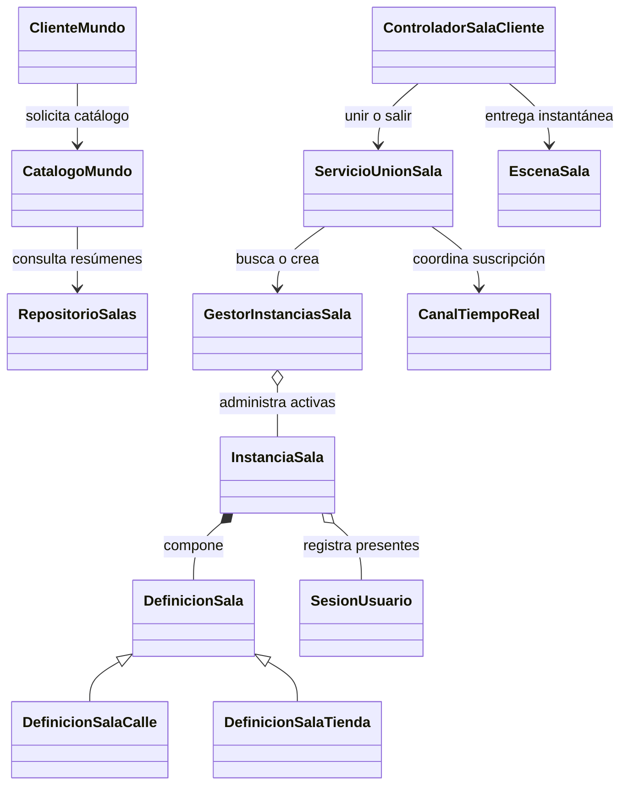
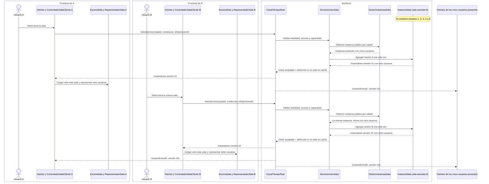
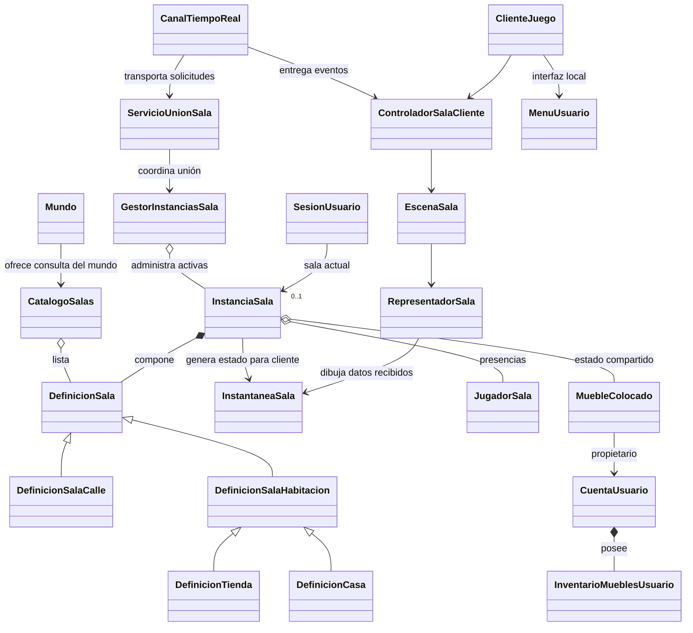

# Arquitectura multijugador: preguntas y propuesta

## Propósito

Este documento reúne las decisiones que conviene resolver antes de implementar
usuarios concurrentes, sesiones de juego o comunicación en tiempo real. No fija
una arquitectura ni modifica el código: primero define qué debe aclararse para
distinguir la cuenta del usuario, el mundo compartido, la definición de una
sala y la sesión activa de esa sala.

La pregunta central es si una sala representa una definición reutilizable, una
instancia compartida por todos sus visitantes o una instancia privada creada
para un grupo. Esa decisión condiciona cómo se carga, quién conserva su estado
y qué autoridad coordina a los jugadores.

## Recomendación inicial para WORSHIP WORLD

Conviene separar **la aplicación cliente**, **el catálogo del mundo**, **la
definición de cada sala** y **la instancia activa compartida**. El navegador
debe representar y solicitar cambios; no debe ser la autoridad que decide el
estado común de los jugadores.

Como primera versión, recomiendo que las salas públicas sean compartidas: todos
los clientes que se unan al mismo identificador reciben el estado de la misma
instancia activa. La geometría y configuración de la sala se reutilizan; los
jugadores conectados y el estado temporal pertenecen a la instancia activa.
Una sala privada podrá tener otra instancia identificada por la sala y el grupo.

La carga debe ser progresiva:

1. Al abrir el juego, cargar el perfil mínimo del usuario y un catálogo liviano
   de salas: identificador, nombre, tipo, ocupación aproximada y, si existe, una
   miniatura. No enviar el escenario completo de todas las salas.
2. Al seleccionar una sala, solicitar unirse usando su identificador.
3. El servidor valida el acceso y encuentra o crea la instancia compartida.
   Devuelve la definición necesaria y una instantánea del estado actual de esa
   sala, no el estado de las demás.
4. El cliente carga los recursos de esa sala, crea su `EscenaSala` y se
   suscribe a los cambios en tiempo real de esa instancia.
5. Al salir, el cliente deja de escuchar esa sala. El servidor puede conservar
   su instancia mientras tenga visitantes y guardarla o liberarla según la
   política definida.

Para no sobredimensionar el proyecto, empezaría con un **backend modular único**
(un solo despliegue, responsabilidades separadas), con una instancia de dominio
por sala activa. No hace falta crear un microservicio o proceso de sistema
operativo por sala. Si la concurrencia lo exige más adelante, el gestor podrá
ubicar instancias en distintos procesos sin cambiar la idea de que una sala
tiene una autoridad definida.

### Responsabilidades orientadas a objetos

La siguiente separación es una propuesta para guiar el refactor; no significa
que estas clases ya existan ni que haya que implementarlas todas de una vez.

| Clase propuesta | Responsabilidad |
| --- | --- |
| `ClienteMundo` | En el navegador, pedir y mostrar resúmenes; no crear todos los escenarios completos. |
| `CatalogoMundo` | En el servidor, buscar y listar resúmenes de salas disponibles. |
| `DefinicionSala` | Mantener datos relativamente estáticos: identificador, nombre, tipo, dimensiones y distribución. |
| `DefinicionSalaCalle` / `DefinicionSalaTienda` | Especializar la configuración estática si las reglas de esos tipos realmente difieren. |
| `InstanciaSala` | Mantener el estado temporal compartido: usuarios presentes, objetos activos y versión del estado. Compone una `DefinicionSala`. |
| `GestorInstanciasSala` | Encontrar o crear la instancia por identificador, controlar ocupación y liberar instancias inactivas. |
| `ServicioUnionSala` | Coordinar validación de acceso, unión, entrega de instantánea y salida. |
| `RepositorioSalas` | Leer definiciones y persistir solo el estado que el juego decida conservar. |
| `SesionUsuario` | Representar la conexión autenticada y la sala a la que pertenece en ese momento. |
| `CanalTiempoReal` | Transportar comandos y eventos entre clientes y la autoridad del servidor. |
| `ControladorSalaCliente` | Solicitar la sala seleccionada, mantener su estado visual y entregar datos a `EscenaSala`. |

`DefinicionSala` y `InstanciaSala` deben relacionarse por **composición**, no
heredar una de la otra: la definición describe qué sala es; la instancia
representa una ejecución compartida de esa definición. La herencia de tipos de
sala puede conservarse donde aporte reglas concretas, pero usuarios y sesiones
no deberían añadirse a `Mundo` ni a la definición estática.



### Estado y tiempo real

El servidor debe ser la autoridad del estado compartido. Un cliente puede
mostrar la respuesta de una acción de inmediato para mejorar la sensación de
fluidez, pero el servidor valida y confirma el resultado antes de publicarlo a
los demás. Los mensajes de tiempo real se limitan a la sala activa; el catálogo
recibe solo cambios resumidos, como ocupación o disponibilidad. La instantánea
inicial y los eventos posteriores necesitan una versión o secuencia para
detectar actualizaciones perdidas o desordenadas.

### Ejemplo real: dos usuarios se unen a una sala con cinco

Supongamos que los usuarios A y B seleccionan `sala-avenida-01`, donde ya están
los usuarios 1 a 5. El servidor tiene una sola `InstanciaSala` activa para ese
identificador. Cada navegador mantiene su propio Phaser; Phaser no contiene la
autoridad ni crea una copia independiente del estado compartido.



El orden importa: la operación de unión debe actualizar la instancia y tomar su
instantánea como una operación ordenada por sala. A recibe la versión 41 con
los cinco usuarios originales y consigo mismo; después recibe el evento de B y
actualiza a siete. B recibe la versión 42 con los cinco originales, A y consigo
mismo. Los cinco clientes que ya estaban reciben los eventos de A y B. El
servidor no reenvía a cada usuario el escenario de todas las salas: la
definición geométrica puede cachearse por identificador y versión, y los
mensajes en vivo contienen solo cambios de esta instancia.

El servidor debe excluir al usuario recién unido del evento que ya está
incluido en su instantánea. También debe usar un identificador de operación
para que un reintento de red no agregue dos veces al mismo usuario. Una
secuencia/versionado permite detectar eventos atrasados; si una instantánea
falla o queda desactualizada, el cliente solicita resincronización. Si la sala
tiene un límite y ya está llena, `ServicioUnionSala` rechaza la unión antes de
modificar la instancia.

El flujo de salida es equivalente: el cliente solicita salir, el servidor quita
la sesión una sola vez y publica `UsuarioSalio` solo a los demás miembros de esa
sala. Cuando la instancia queda vacía, `GestorInstanciasSala` la conserva o la
libera según la política de persistencia. Si hay muchos usuarios, la
serialización de cambios se hace por instancia de sala; no se bloquea el mundo
completo para procesar una entrada.

El repositorio actual es principalmente una aplicación Astro/Phaser en el
navegador: `Mundo` construye salas locales y `Sala` contiene jugadores y
elementos en memoria, pero todavía no hay una autoridad de servidor, carga
perezosa desde API, persistencia ni sincronización multijugador. Por ello, esta
recomendación describe una evolución, no una capacidad ya implementada. Phaser
y `EscenaSala` deben quedarse en el cliente; el servidor no debe dibujar.

### Cambios arquitectónicos propuestos, sin implementación

1. Tratar `Mundo` del cliente como catálogo de resúmenes, no como contenedor de
   todas las salas espaciales inicializadas.
2. Separar el modelo estático actual de `Sala` del estado temporal de
   visitantes: mover dimensiones y distribución a una definición reutilizable;
   colocar ocupantes y cambios de sesión en `InstanciaSala`.
3. Hacer que la página envíe solo el identificador de la sala seleccionada.
   Obtener sus detalles al entrar y descargar recursos visuales solo cuando
   hagan falta.
4. Incorporar el gestor de instancias y el servicio de unión en el backend,
   manteniendo un backend modular único al principio.
5. Mantener el renderizador actual como adaptador cliente: recibe la definición
   y la instantánea de la instancia seleccionada, pero no decide el estado
   compartido.
6. Diseñar mensajes de unión, salida, instantánea y actualización. Añadir el
   transporte en tiempo real y persistencia únicamente después de definir esos
   contratos y las reglas de autoridad.

## Propuesta según la estructura de WORSHIP WORLD

La jerarquía que propones sirve para navegar el mundo, pero no conviene
representarla literalmente como `Mundo -> Sala -> Usuarios`. Las salas son
definiciones del catálogo; los usuarios son sesiones que entran y salen de
instancias activas. Una cuenta no debería quedar contenida permanentemente en
una sala.

### Modelo de dominio POO

- `CatalogoSalas` administra las definiciones disponibles en `Mundo`.
- `DefinicionSala` contiene datos estables: id, nombre, categoría, dimensiones,
  distribución y versión. `DefinicionSalaCalle` es una especialización aparte.
- `DefinicionSalaHabitacion` puede ser la clase base de `DefinicionTienda`,
  `DefinicionCasa` y otros interiores. Tienda y casa son tipos de habitación,
  no habitaciones contenidas dentro de otra habitación.
- `InstanciaSala` compone una `DefinicionSala` y mantiene el estado compartido
  mientras la sala está activa: ocupantes, muebles colocados y versión.
- `CuentaUsuario` conserva nombre de perfil y datos persistentes.
  `SesionUsuario` representa una conexión activa y su `salaActualId`, que puede
  señalar como máximo una sala.
- `JugadorSala` representa la presencia temporal de una sesión dentro de una
  instancia. No es la cuenta completa del usuario.
- `InventarioMueblesUsuario` conserva los muebles que posee cada usuario.
  `MuebleColocado` representa una unidad específica puesta en una sala.



La flecha de `SesionUsuario` a `InstanciaSala` expresa pertenencia de sesión:
el backend debe garantizar que cada sesión esté en cero o una sala. La
instancia puede tener muchas presencias. Cambiar de sala debe ser una operación
coordinada: comprobar que el destino acepta al usuario, quitarlo de la anterior,
añadirlo a la nueva y entregar la instantánea del destino. Si el destino
rechaza la entrada, la sesión conserva la sala anterior.

### Reparto entre frontend, backend y motor gráfico

| Parte | Responsabilidades |
| --- | --- |
| Frontend | Mostrar el catálogo resumido, el perfil, la navegación y el menú privado del usuario. Mantener una sola sala activa por cliente. |
| Backend | Validar sesiones y permisos; buscar instancias compartidas; gestionar entradas, salidas, inventarios y colocación de muebles; publicar eventos de la sala. |
| Motor gráfico (Phaser) | Dibujar solo la sala seleccionada con su definición e instantánea. Representar jugadores y muebles visibles; no autenticar ni decidir quién posee un mueble. |
| Persistencia | Guardar definiciones, perfiles, inventarios y el estado de sala que se haya decidido conservar. No enviar todos esos datos a cada navegador. |

Cada usuario tiene su propio `MenuUsuario` en su navegador; abrir o cerrar ese
menú es estado local y no se transmite. El nombre público del usuario sí puede
mostrarse sobre su avatar a los demás en la sala, pero no se comparte su menú ni
su inventario completo. Al abrir el menú, el cliente solicita el inventario del
usuario; no necesita descargarlo al cargar el mundo.

### Flujo del usuario y los muebles

1. **Entrada al mundo:** el frontend carga el perfil mínimo y resúmenes de
   salas. No crea ni dibuja todas las escenas.
2. **Selección:** el usuario elige una calle, casa o tienda. El controlador
   solicita al backend el cambio a ese `idSala`.
3. **Unión:** el backend obtiene o crea la instancia pública de esa sala, valida
   capacidad y permisos, registra la sesión y devuelve la definición necesaria
   si no está en caché, más una instantánea del estado actual.
4. **Representación:** el cliente deja de mostrar la escena anterior y Phaser
   muestra solo la nueva. Se mantiene una instancia de `Phaser.Game` por
   navegador; los clientes distintos representan la misma instancia de sala.
5. **Tiempo real:** el backend envía a los miembros de esa sala eventos como
   `UsuarioEntro`, `UsuarioSalio`, `MuebleColocado` y `MuebleRetirado`. No
   difunde esos eventos a todos los usuarios del mundo.
6. **Mueble:** desde su menú, el usuario solicita colocar una unidad de su
   inventario. El backend verifica propiedad, permisos y posición válida;
   actualiza inventario e instancia y notifica el resultado a los miembros de
   esa sala. Al retirar un mueble, aplica la regla acordada para devolverlo a su
   propietario o al inventario de la habitación.

La colección visual de muebles disponibles puede cargarse al abrir el menú;
los datos completos de un mueble solo se necesitan cuando se selecciona para
colocarlo. Para otros jugadores basta enviar los datos públicos requeridos
para dibujar los muebles ya colocados.

### Refactor gradual recomendado

1. Conservar `Mundo`, `Sala`, `SalaCalle` y `SalaTienda` como modelo local actual,
   pero separar los contratos de **resumen**, **definición** y **estado de una
   instancia**; no enviar instancias de clase por la red.
2. Separar el estado temporal de usuarios y muebles de la definición estática
   de sala. Usar composición entre `InstanciaSala` y `DefinicionSala`.
3. Añadir `SesionUsuario` y un servicio de cambio de sala que garantice una sola
   pertenencia activa y actualizaciones idempotentes.
4. Añadir inventario y reglas de colocación del lado del servidor antes de
   habilitar acciones de muebles compartidas.
5. Conectar un canal de tiempo real por instancia y adaptar el controlador
   Phaser para consumir instantáneas y eventos; mantener la interfaz privada
   del usuario en el frontend.

La propuesta mantiene un backend modular único al principio. No requiere un
proceso o microservicio por sala; `GestorInstanciasSala` puede administrar
muchas instancias en el mismo servidor y permitir distribuirlas más adelante.

## Diez preguntas por resolver

1. **¿Qué significa que una sala sea compartida?**  
   ¿Todos los usuarios que eligen, por ejemplo, la plaza principal entran a la
   misma instancia y ven a los mismos jugadores, o cada usuario/grupo obtiene
   una copia independiente? ¿Hay salas públicas y privadas?

2. **¿Qué componente tiene la autoridad sobre el estado de juego?**  
   ¿Un servidor central valida posiciones, entradas y cambios de sala, o cada
   cliente puede modificar el estado local? ¿Qué datos puede predecir el cliente
   y cuáles debe confirmar la autoridad?

3. **¿Qué diferencia existe entre el mundo, una definición de sala y una
   instancia activa?**  
   ¿`Mundo` es un catálogo de salas disponibles, un proceso que mantiene salas
   activas o ambas cosas? ¿Se necesita separar la configuración estática
   (nombre, dimensiones y distribución) del estado temporal de una visita?

4. **¿Qué información pertenece al usuario y cómo se carga?**  
   ¿Qué identifica al usuario (cuenta, sesión o invitado)? ¿Dónde viven su
   perfil y preferencias, y cuándo se cargan: antes de entrar al mundo o al
   seleccionar una sala? ¿Qué información nunca debe confiarse al cliente?

5. **¿Qué estado de una sala debe persistir?**  
   ¿Se guardan solo sus datos de diseño o también ocupación, objetos colocados,
   cambios temporales y mensajes? ¿Qué se conserva al quedar vacía y qué se
   reinicia al cerrar una instancia?

6. **¿Cómo se crea, encuentra y descarga una instancia de sala?**  
   Cuando una persona selecciona una sala, ¿el sistema la busca entre
   instancias existentes o crea una nueva? ¿Qué ocurre si está llena, no está
   activa o falla su carga? ¿Cuándo se libera una sala sin visitantes?

7. **¿Cómo se distribuye la carga cuando aumentan usuarios y salas?**  
   ¿Un proceso puede alojar todas las salas o se asignan instancias a distintos
   servidores? ¿Qué límites de usuarios por sala se necesitan y cómo se evita
   que dos servidores crean ser la autoridad de la misma instancia?

8. **¿Cómo se sincronizan los cambios entre clientes?**  
   ¿Qué eventos o estados se envían, con qué frecuencia y en qué orden? ¿Se
   transmite un estado completo al entrar y luego cambios incrementales? ¿Qué
   protocolo y mecanismos de validación, reintento y control de mensajes se
   requieren?

9. **¿Qué debe pasar ante desconexiones y reconexiones?**  
   ¿Cuánto tiempo se conserva la sesión del jugador? ¿Cómo vuelve a la sala
   correcta y recupera el estado reciente? ¿Cómo se evita duplicarlo si la
   conexión anterior tarda en expirar?

10. **¿Qué permisos y límites rigen la entrada y la administración?**  
    ¿Quién puede descubrir, entrar, crear o modificar salas? ¿Cómo se manejan
    invitaciones, capacidad, salas privadas, expulsiones y moderación? ¿Qué
    acciones deben quedar registradas?

## Prompt para pedir el análisis a una IA

```text
Actúa como arquitecto de software especializado en juegos sociales
multijugador en tiempo real con TypeScript.

Analiza el repositorio WORSHIP WORLD antes de recomendar cambios. Inspecciona
las clases y flujos existentes relacionados con Mundo, Sala, SalaCalle,
SalaTienda, EscenarioSala, la interfaz y Phaser. Basa tus conclusiones en el
código actual y señala con claridad qué es una capacidad existente y qué es
solo una propuesta.

Necesito decidir cómo separar conceptualmente:
- la identidad, sesión y datos de cada usuario;
- el catálogo y estado del mundo;
- la definición/configuración de una sala;
- una instancia activa y posiblemente compartida de esa sala;
- la representación local en el cliente;
- la autoridad que valida y sincroniza a varios jugadores.

Responde en español y resuelve las diez preguntas de
documentacion/arquitectura/preguntas-arquitectura-multijugador.md. Para cada
una:
1. presenta las alternativas razonables;
2. explica ventajas, costes y riesgos;
3. recomienda una opción para una primera versión y justifica qué podría
   cambiar al crecer el juego.

Aclara expresamente si una sala es una definición reutilizable, una instancia
compartida o una copia privada; cómo un usuario la encuentra y se une; qué
componente conserva el estado autoritativo; cómo se carga y libera la instancia;
y qué información se envía al cliente.

Entrega también:
- una propuesta de límites y responsabilidades entre módulos, sin asumir que
  cada módulo necesita ser un servidor o microservicio;
- una estrategia de carga progresiva: perfil y resúmenes al inicio, definición
  y estado solo para la sala seleccionada, y actualizaciones solo de esa sala;
- una propuesta POO que separe `DefinicionSala` de `InstanciaSala` y mantenga
  al cliente como representación, no como autoridad;
- un diagrama Mermaid del flujo usuario → mundo → unión a sala → sincronización;
- una lista de decisiones que todavía requieren respuesta del equipo;
- un plan de implementación incremental, con dependencias entre pasos y
  pruebas conceptuales para cada paso.

No escribas ni modifiques código todavía. No instales dependencias ni cambies
archivos de configuración. No des por decidido ningún comportamiento que no
esté especificado: marca las dudas y explica qué pregunta hay que contestar
antes de implementar.
```

## Criterio para continuar

Antes de implementar la arquitectura, el equipo debe acordar al menos el modelo
de sala compartida o privada, la autoridad del estado, la persistencia requerida
y el flujo de unión/reconexión. Después se puede convertir la recomendación en
fases de implementación verificables, sin adelantar una solución distribuida
innecesaria.
